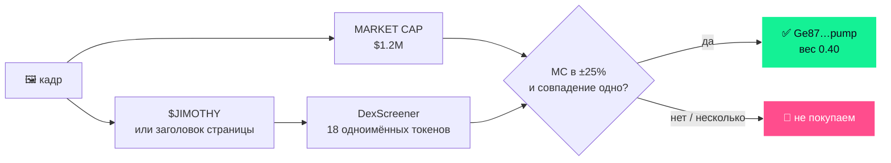

<div align="center">



<br/>

<a href="#-quick-start"></a>
<a href="#-как-это-работает"></a>
<a href="#-latency"></a>
<a href="#%EF%B8%8F-configuration"></a>

<br/><br/>


<h3>👁 Смотрит стрим &nbsp;·&nbsp; 🎙 слушает стримера &nbsp;·&nbsp; ⚡ заходит в токен одной транзакцией</h3>

<p>
Ловит момент, когда стример заходит в токен, — по экрану <b>и</b> по голосу —<br/>
и покупает его на <b>pump.fun bonding curve</b> или, если токен уже мигрировал, на <b>PumpSwap</b>.<br/>
Одна подписанная tx сразу во все релеи: <b>Helius Sender ‖ Jito ‖ RPC</b>.
</p>

</div>

---

## 📑 Содержание

<table>
<tr>
<td valign="top">

- [✨ Фичи](#-фичи)
- [🧠 Как это работает](#-как-это-работает)
- [🎯 Dual detection](#-dual-detection-visual--audio)
- [🔎 Опознание без адреса](#-опознание-токена-без-адреса)

</td>
<td valign="top">

- [⏱ Latency](#-latency)
- [💊 pump.fun & PumpSwap](#-pumpfun--pumpswap)
- [🛡 Риск-менеджмент](#-риск-менеджмент)
- [🏗 Архитектура](#-архитектура)

</td>
<td valign="top">

- [🚀 Quick start](#-quick-start)
- [⚙️ Configuration](#%EF%B8%8F-configuration)
- [🧪 Dev & debug](#-development--debugging)
- [✅ CAN / ❌ CANNOT](#-can--cannot)

</td>
</tr>
</table>

---

## ✨ Фичи

<table>
<tr>
<td width="50%" valign="top">

### 👁 Vision
- **Apple Vision** на Neural Engine — **118 мс/кадр**
- mint-адреса, `$TICKER`, платформа, действие стримера
- 🩹 **починка OCR-ошибок** в mint (`1→I`, `2→Z`, `o→0`) с проверкой на mainnet
- 📊 market cap / ликвидность / холдеры прямо с экрана

</td>
<td width="50%" valign="top">

### 🎙 Audio
- **faster-whisper** + VAD — **398 мс** на 3-секундный чанк
- keyword spotter: «aping in», «just bought», тикеры
- отрицания и «rug / scam / stay away» гасят сигнал
- buy-фраза привязывается только к mint, видимому ±2 с

</td>
</tr>
<tr>
<td width="50%" valign="top">

### ⚡ Execution (Rust)
- pump.fun **v3** (`buy_exact_quote_in_v3`, 17 аккаунтов)
- **PumpSwap v2** для мигрировавших токенов (wrap → buy → unwrap в одной tx)
- квоты — порт официального `pump-rust-client`, **сверены до лампорта**
- fan-out: Helius Sender ‖ Jito (multi-region) ‖ RPC, live-tip и live-priority fee

</td>
<td width="50%" valign="top">

### 🛡 Safety
- «не попала» = высота блока > `lastValidBlockHeight`, а не таймер
- себестоимость из **реальной дельты баланса** tx
- журнал позиций + восстановление после рестарта
- TP / SL / trailing / timeout по **реальной стоимости позиции**
- лимиты сессии, защита от второго экземпляра

</td>
</tr>
</table>

---

## 🧠 Как это работает

```mermaid
flowchart LR
    S(["📺 Stream<br/>Twitch · Kick · YouTube"]) --> C["🎞 Capture<br/>ffmpeg 3 fps + PCM 16k"]
    C --> V["👁 Vision<br/>OCR · mint · $TICKER · MC"]
    C --> A["🎙 Audio<br/>Whisper · keywords"]
    V --> G{"🧮 Signal<br/>score ≥ 0.7"}
    A --> G
    V -. "нет адреса" .-> R["🔎 Resolver<br/>тикер + market cap"]
    R --> G
    G -- "NDJSON / UDS" --> E["🦀 Executor<br/>quote · build · sign"]
    E --> Q{"curve<br/>complete?"}
    Q -- "нет" --> BC["💊 pump.fun v3"]
    Q -- "да" --> PS["🌊 PumpSwap v2"]
    BC --> L["⚡ Sender ‖ Jito ‖ RPC"]
    PS --> L
    L --> M["📈 Monitor<br/>TP · SL · trailing · timeout"]
    M --> J[("📒 journal")]

    classDef stream fill:#FF2E4D,stroke:#fff,color:#fff
    classDef py fill:#9945FF,stroke:#d6bcff,color:#fff
    classDef rs fill:#0f3d2e,stroke:#14F195,color:#fff
    classDef land fill:#00C2FF,stroke:#fff,color:#0b0618
    class S stream
    class C,V,A,G,R py
    class E,Q,BC,PS,M,J rs
    class L land
```



<details open>
<summary><b>🔬 Пошагово</b></summary>

<br/>

| # | Этап | Что происходит |
|:-:|---|---|
| 1️⃣ | **Capture** | `streamlink`/`yt-dlp` достают прямой URL, два `ffmpeg` выдают кадры 1280×720 (3 fps) и PCM 16 kHz по 3 с. Обрыв → переподключение с backoff 1→30 с; watchdog убивает зависший ffmpeg через 15 с без данных. Всегда анализируется самый свежий кадр — задержка не копится. |
| 2️⃣ | **Vision** | OCR (Apple Vision или EasyOCR) → Solana-адреса, `$TICKER`, платформа, действие стримера, метрики токена. Испорченный pump-mint чинится: кандидаты проверяются одним `getMultipleAccounts`. |
| 3️⃣ | **Audio** | faster-whisper с VAD транскрибирует речь, keyword spotter ловит торговые фразы и тикеры. |
| 4️⃣ | **Signal** | Окна vision 3 с / audio 10 с, confidence 0…1, cooldown по токену. Mint должен быть виден ≥ 2 кадров; несколько разных mint на экране (чат-оверлей) → BUY не уходит. |
| 5️⃣ | **Quote & build** | Один RPC round-trip: кривая + mint + канонический PumpSwap-пул и его хранилища ‖ priority fee ‖ blockhash ‖ баланс. Дальше — v3 на кривой или v2 на пуле, с точными комиссиями. |
| 6️⃣ | **Land** | Одна подпись во все релеи — исполнится не больше одного раза. Статус каждые 200 мс, засчитывается только `confirmed`. |
| 7️⃣ | **Manage** | Выход по стоимости позиции (сколько вернёт продажа всего сейчас, с комиссиями) против реальной себестоимости. Продажа всего баланса + закрытие ATA (возврат ~0.002 SOL rent). Slippage на выходе растёт до `EXIT_SLIPPAGE_PCT`. |
| 8️⃣ | **Journal** | `logs/positions.json` (атомарно) + `logs/trades.jsonl`. После рестарта — сверка с on-chain балансами. |

</details>

---

## 🎯 Dual detection: Visual + Audio

| Признак | Канал | Вес |
|---|:-:|:-:|
| 🔑 mint-адрес на экране, ≥ 2 кадров (× 0.8–1.0 по OCR-confidence; восстановленный ≤ 0.9) | 👁 | **+0.50** |
| 🔎 mint, опознанный по тикеру + market cap | 👁 | **+0.40** |
| 💲 `$TICKER` на экране | 👁 | +0.20 |
| 🖥 распознана торговая платформа | 👁 | +0.15 |
| 👀 смотрит токен / 🖱 на кнопке Buy / ✅ купил | 👁 | +0.10 / +0.30 / +0.40 |
| 🗣 buy-фраза в речи | 🎙 | +0.30 |
| 🏷 тикер в речи | 🎙 | +0.15 |
| 🤝 оба канала подтверждают один токен | 👁🎙 | **+0.20** |
| ⚠️ тикер без mint (риск копиката) | — | −0.15 |

> [!TIP]
> Сумма обрезается до 1.0, порог исполнения — **0.7**.
> Mint на экране + платформа + buy-фраза = **0.95 ✅**. Только buy-фраза с тикером в речи = **0.30 ❌**.

Короткие бытовые фразы («let's go», «I'm in») — **не** buy-фразы. SELL — только явные («sold it», «taking profits», «I'm out»).

---

## 🔎 Опознание токена без адреса

Стримеры редко показывают CA — чаще страницу токена с тикером, графиком и капитализацией. Тикер у мемкоинов не уникален (десятки копий), а **тикер + market cap** почти всегда однозначны.



Живой эфир: `identified $JIMOTHY at MC $1.20M → Ge87…pump (unique of 18)` — **за 0.7 с**. ATH, объём и % изменения рядом с капитализацией игнорируются (`vision/metrics.py`).

---

## ⏱ Latency

<sub>Замеры 2026-11-09 · Apple M1 · без NVIDIA · публичный RPC. На своём железе смотрите `SESSION STATS` и логи executor'а.</sub>

| Этап | Замер | Как получено |
|---|:-:|---|
| 📺 Задержка самой платформы стрима | секунды | вне нашего контроля |
| 🎞 Ожидание кадра / аудио-чанка | ≤ 333 мс / ≤ 3 с | `STREAM_FPS=3`, `STREAM_AUDIO_CHUNK_SEC=3` |
| 👁 OCR кадра, Apple Vision | 🟢 **118 мс avg / 179 мс p95** | живой эфир, 201 кадр |
| 👁 OCR кадра, EasyOCR MPS / CPU | 🟡 748 мс / 🔴 7–9 с | живой эфир / синтетика |
| 🎙 Whisper `base.en` (CPU int8), 3 с аудио | 🟢 **398 мс avg / 522 мс p95** | живой эфир |
| 🩹 Восстановление mint | 0.4–1.1 с, из кеша ~0 мс | публичный RPC |
| 🔎 Опознание по тикеру + MC | ~0.7 с (фоном) | DexScreener |
| 🧮 Агрегация + скоринг | ~0.1 мс | smoke test |
| 🔌 IPC Python → Rust | < 1 мс | smoke test |
| 🦀 Состояние + квота + сборка | 🟢 **~130–157 мс** (1 round-trip) | dry-run на mainnet |
| 🚀 Принятие релеем | 115 мс (RPC) … 0.5–0.9 с (Sender / Jito из EU) | `--probe-relays` |
| 💸 Round trip (buy → sell сразу) | **−2.5%** кривая · **−0.6…−2%** PumpSwap | комиссии, `--selfcheck*` |

> [!NOTE]
> Слоты mainnet с октября 2026 — **200 мс**, blockhash живёт ~30 с. Executor обновляет его каждые 2 с и никогда не подписывает хешем старше 10 с.

---

## 💊 pump.fun & PumpSwap

Источник истины — [pump-fun/pump-public-docs](https://github.com/pump-fun/pump-public-docs) (IDL от 2026-10-13).

<table>
<tr>
<th width="50%">💊 Bonding curve (v3)</th>
<th width="50%">🌊 PumpSwap (v2)</th>
</tr>
<tr>
<td valign="top">

- `buy_exact_quote_in_v3` / `sell_v3` — 17 аккаунтов вместо 26–27
- комиссии из pump-fees `FeeConfig`
- **`--selfcheck`**: квота buy = симуляция до единицы токена, полный выход (buy → sell → close ATA) — **до лампорта** на 3 mayhem-коинах
- 🔥 mayhem-коины поддерживаются
- buy 70–75k CU, sell 46k CU

</td>
<td valign="top">

- `buy_exact_quote_in_v2` / `sell_v2`, wrap SOL → trade → unwrap в той же tx
- комиссии LP / protocol / creator по тирам капитализации
- **`--selfcheck-amm`** на 3 пулах — покупка и выход **до лампорта**
- 🔁 позиция на кривой, которая мигрировала во время удержания, сама переезжает на пул
- buy 81–84k CU, round trip 139–143k CU

</td>
</tr>
</table>

<details>
<summary><b>🚫 Что отклоняется и почему</b></summary>

<br/>

- кривая квотирована не в SOL; cashback-коины (v3/v2 их не принимают); cashback-пулы и пулы не в wSOL;
- покупка, пересекающая остаток кривой (synthetic migration); продажа больше реальных резервов кривой;
- старые «короткие» аккаунты кривой читаются с нулевым добором — как в официальном декодере.

**Кривые не в SOL.** Официальный путь — PumpSwap `multi_hop_swap`. Но все встреченные на mainnet не-SOL цепочки заканчиваются **xStock**'ами (`Xs…`, токенизированные акции, Token-2022 с pausable/transfer-hook), а ни один pump-маршрут не ведёт к ним из SOL. Поэтому multi-hop отложен. `--inspect <MINT>` показывает цепочку квот.

</details>

---

## 🛡 Риск-менеджмент

<table>
<tr>
<td align="center" width="25%">🎯<br/><b>Take-profit</b><br/><code>2.0×</code></td>
<td align="center" width="25%">🛑<br/><b>Stop-loss</b><br/><code>0.6×</code></td>
<td align="center" width="25%">📉<br/><b>Trailing</b><br/><code>−25% от пика</code><br/><sub>взводится на 1.2×</sub></td>
<td align="center" width="25%">⏳<br/><b>Timeout</b><br/><code>120 с</code></td>
</tr>
<tr>
<td align="center">💀<br/><b>Session loss</b><br/><code>3 × BUY_SOL</code></td>
<td align="center">🔁<br/><b>Loss streak</b><br/><code>5 подряд</code></td>
<td align="center">🏦<br/><b>SOL reserve</b><br/><code>0.01 SOL</code></td>
<td align="center">⌛<br/><b>Signal age</b><br/><code>≤ 6 с</code></td>
</tr>
</table>

- ✅ **Landing reconcile** — tx, приземлившаяся позже «таймаута», не превращается в неучтённые токены и повторную покупку
- ✅ **Single instance** — второй executor на том же сокете не стартует (bind до открытия журнала)
- ✅ **Paper-честность** — бумажная позиция учитывает собственную покупку на кривой / в пуле

---

## 🏗 Архитектура

```
mev-streamer/
├── 📺 ingestion/          Module 1 · захват стрима (streamlink / yt-dlp + ffmpeg, watchdog)
├── 👁 vision/             Module 2 · экран
│   ├── ocr.py             Apple Vision / EasyOCR / Tesseract, ROI
│   ├── detector.py        Solana-адреса, тикеры, «почти-адреса»
│   ├── mint_repair.py     исправление OCR-ошибок + on-chain проверка
│   ├── metrics.py         market cap / liquidity / holders с экрана
│   ├── ui_recognizer.py   платформа + действие
│   └── pipeline.py        VisionPipeline
├── 🎙 audio/              Module 3 · речь (faster-whisper + keyword spotter)
├── 🧮 signal/             Module 4 · решение (orchestrator, aggregator, resolver, ipc)
├── 🦀 executor/src/       Module 5 · исполнение (Rust)
│   ├── main.rs            buy/sell, сверка с on-chain, risk, восстановление
│   ├── bonding.rs         BondingCurve / Global / FeeConfig + v3-квоты
│   ├── pumpswap.rs        PumpSwap v2: Pool / GlobalConfig / FeeConfig, квоты, wrap/unwrap
│   ├── tx_builder.rs      v3 buy/sell, compute budget, tips, close ATA
│   ├── sender.rs          fan-out Sender ‖ Jito ‖ RPC, подтверждение по высоте блока
│   ├── jito.rs            sendTransaction (bundleOnly), live tip_floor
│   ├── position.rs        TP / SL / trailing / timeout, venue, миграция
│   ├── journal.rs         positions.json + trades.jsonl
│   ├── selfcheck.rs       --selfcheck · --selfcheck-amm · --inspect · --probe-relays
│   ├── rpc.rs · pda.rs · config.rs · ipc.rs · types.rs
├── 🛠 scripts/            build · monitor · dry-run · run · check · smoke_test · unit_checks
└── 🎨 assets/             баннер README
```

<details>
<summary><b>🔌 IPC-протокол</b> — NDJSON по Unix-сокету <code>/tmp/mev-streamer.sock</code> (0600)</summary>

```json
→ {"mint":"…pump","ticker":"X","action":"buy","confidence":0.85,"source":"both","context":"…","timestamp":1699999999.1}
← {"status":"ok","bundle_id":"<signature>"}      // "dry-run" в DRY_RUN
← {"status":"error","message":"…"}
```

</details>

---

## 🚀 Quick start

> **Нужны:** Python 3.11+ (лучше 3.13) · Rust · `ffmpeg`

```bash
./scripts/build.sh                                  # 📦 .venv, зависимости, cargo build, .env
$EDITOR .env                                        # 🔧 RPC_URL, STREAM_URL; WALLET_PRIVATE_KEY только для live
./scripts/check.sh                                  # 🧪 связка модулей без стрима и GPU
```

<table>
<tr>
<th>1️⃣ Смотреть</th>
<th>2️⃣ Paper</th>
<th>3️⃣ Live</th>
</tr>
<tr>
<td>

```bash
./scripts/monitor.sh \
  --stream "twitch.tv/name"
```

</td>
<td>

```bash
./scripts/dry-run.sh \
  --stream "twitch.tv/name"
```

</td>
<td>

```bash
./scripts/run.sh \
  --stream "twitch.tv/name"
```

</td>
</tr>
<tr>
<td>сигналы печатаются, никуда не уходят</td>
<td>настоящая tx симулируется на mainnet, позиция бумажная → <code>logs/trades.dry.jsonl</code></td>
<td><b>реальные сделки</b>: <code>DRY_RUN=false</code>, ключ и ввод <code>LIVE</code></td>
</tr>
</table>

Перед первым live:

```bash
X=executor/target/release/mev-streamer-executor
$X --new-wallet ~/mevs-key.txt      # 🔑 отдельный hot-кошелёк для бота
$X --selfcheck <MINT на кривой>     # 🎯 buy + полный выход против mainnet-симуляции
$X --selfcheck-amm <MINT на пуле>   # 🌊 то же для PumpSwap
$X --probe-relays                   # 📡 релеи принимают формат? ничего не тратит
```

> [!IMPORTANT]
> Сначала `dry-run.sh` на нескольких реальных стримах и разбор `logs/trades.dry.jsonl`. Базовая линия (случайные свежие токены, выход по таймауту 120 с): **13 сделок, −2.65% = комиссии**. Сигнал со стрима должен давать больше ~2.5%, иначе края нет.

---

## ⚙️ Configuration

Все модули читают `.env` из корня; переменные окружения его перекрывают.

<details open>
<summary><b>🌐 Основное</b></summary>

| Переменная | По умолч. | Описание |
|---|:-:|---|
| `RPC_URL` | — | Solana RPC (свой / Helius — сильно быстрее публичного) |
| `WALLET_PRIVATE_KEY` | пусто | base58, 64 байта; пусто → эфемерный ключ, только DRY_RUN |
| `STREAM_URL` | — | или `--stream` |
| `DRY_RUN` | `true` | см. режимы |
| `BUY_SOL` | — | бюджет входа (комиссии внутри него) |

</details>

<details>
<summary><b>👁🎙 Захват, vision, audio, signal</b></summary>

| Переменная | По умолч. | Описание |
|---|:-:|---|
| `STREAM_FPS` / `STREAM_AUDIO_CHUNK_SEC` | 3 / 3 | с Apple Vision можно поднять FPS до 5 |
| `STREAM_RESOLUTION` | `1280:720` | |
| `CAPTURE_STALL_TIMEOUT_SEC` | 15 | перезапуск ffmpeg без данных |
| `OCR_ENGINE` | `auto` | `auto` / `applevision` / `easyocr` / `tesseract` |
| `OCR_GPU` / `OCR_MIN_CONFIDENCE` | true / 0.4 | для EasyOCR |
| `VISION_ROI_MODE` | `auto` | весь кадр для Apple Vision, зоны для остальных |
| `VISION_MINT_REPAIR` | true | исправление OCR-ошибок в mint |
| `UI_DETECTION` | true | платформа и действие |
| `WHISPER_MODEL` / `WHISPER_DEVICE` | `base.en` / auto | CUDA если есть, иначе CPU int8 |
| `SIGNAL_THRESHOLD` / `SIGNAL_COOLDOWN_SEC` | 0.7 / 60 | |
| `ALLOW_TICKER_ONLY` | false | BUY без mint на экране (риск копиката) |
| `HELIUS_API_KEY` | из `RPC_URL` | проверка mint при резолве тикера |

</details>

<details>
<summary><b>⚡ Отправка и комиссии</b></summary>

| Переменная | По умолч. | Описание |
|---|:-:|---|
| `RELAYS` | `sender,jito` | `sender`, `jito`, `rpc` — через запятую |
| `JITO_TIP` / `JITO_TIP_MAX` | `auto` / 0.001 | auto = p75 из Jito `tip_floor` (раз в 2 с) |
| `JITO_URLS` | global | несколько регионов через запятую |
| `SENDER_TIP` / `HELIUS_SENDER_URL` | 0.000005 / `/fast` | ≥ 0.001 → Sender Max, меньше → `?swqos_only=true` |
| `PRIORITY_FEE` | `auto` | p75 недавних комиссий по этой кривой в `[MIN, MAX]` µL/CU |
| `CU_LIMIT_BUY` / `CU_LIMIT_SELL` | 90000 / 60000 | кривая; замер buy 70–75k, sell 46k |
| `CU_LIMIT_AMM_BUY` / `CU_LIMIT_AMM_SELL` | 100000 / 75000 | PumpSwap; замер buy 81–84k, sell ~58k |
| `SIM_PAYER` | системный кошелёк | от чьего имени симулировать в DRY_RUN без ключа |

</details>

<details>
<summary><b>🛡 Выходы и лимиты</b></summary>

| Переменная | По умолч. | Описание |
|---|:-:|---|
| `TAKE_PROFIT` / `STOP_LOSS` / `TIMEOUT_SEC` | 2.0 / 0.6 / 120 | множители **стоимости позиции** к себестоимости |
| `TRAILING_STOP` | 0.25 | на 25% ниже пика, когда пик ≥ 1.2×; 0 = выкл |
| `SLIPPAGE_PCT` / `EXIT_SLIPPAGE_PCT` | 15 / 40 | вход и TP / потолок для SL, timeout, повторов |
| `MAX_POSITIONS` | 3 | одновременно |
| `MAX_SESSION_LOSS` | 3 × `BUY_SOL` | реализованный убыток → покупки стоп; 0 = выкл |
| `MAX_CONSECUTIVE_LOSSES` | 5 | подряд убыточных → стоп |
| `MIN_SOL_RESERVE` | 0.01 | остаток на кошельке на выход |
| `MAX_SIGNAL_AGE_MS` | 6000 | старше — отброшен |
| `MIN_CONFIDENCE` / `MAX_MCAP_SOL` / `REBUY` | 0 / выкл / false | доп. фильтры |
| `MONITOR_INTERVAL_MS` / `STATE_DIR` | 400 / `logs` | опрос выходов / журнал |
| `IPC_SOCKET_PATH` / `SOCKET_PATH` | `/tmp/mev-streamer.sock` | скрипты синхронизируют обе |

</details>

---

## 💻 Hardware

| | 🍎 Mac (Apple Silicon) | 🟩 Linux/Windows + NVIDIA | 🐢 CPU-only без Apple Vision |
|---|---|---|---|
| **OCR** | Apple Vision ~0.1 с/кадр (ANE) | EasyOCR на CUDA | EasyOCR 7–9 с/кадр — Tesseract или `STREAM_FPS=1` |
| **Whisper** | `base.en` int8 ~0.4 с/чанк | `small.en` float16 | `tiny.en` / `base.en` |

Перегрузку видно по `audio отстаёт на Ns` и росту `skipped stale frames`. Executor лёгкий всегда — время уходит в RPC и сеть: свой RPC и релей рядом важнее железа.

---

## 🧪 Development & debugging

```bash
./scripts/check.sh              # cargo test (43) · compileall · keyword spotter · mint repair · unit checks (56) · smoke
./scripts/check.sh --network    # + smoke test с настоящим executor'ом
$X --inspect <MINT>             # цепочка квот, где торгуется каждый уровень
```

Модули по отдельности — как скрипты (не `python -m` из корня: папка `signal/` затеняет stdlib):

```bash
.venv/bin/python ingestion/capture.py twitch.tv/name --seconds 10 --save-frame /tmp/f.png
.venv/bin/python vision/pipeline.py screenshot.png --resize --text --engine applevision
.venv/bin/python audio/pipeline.py --text "aping into PEPE right now"
.venv/bin/python signal/ipc.py --mock
```

---

## ✅ CAN / ❌ CANNOT

<table>
<tr>
<th width="50%">✅ Может</th>
<th width="50%">❌ Не может</th>
</tr>
<tr>
<td valign="top">

- читать с экрана mint, тикеры, платформу, действие стримера и **чинить OCR-ошибки** в адресе
- **опознать токен без адреса** по тикеру + экранной капитализации
- слышать торговые фразы и тикеры
- торговать на **кривой (v3)** и на **PumpSwap (v2)** с точными комиссиями
- слать одну tx в Helius Sender, Jito (multi-region) и RPC
- вести позиции по реальной стоимости, в т.ч. бумажные
- переживать рестарт и не купить дважды из-за ложного «таймаута»
- останавливаться по лимитам сессии
- проверять себя против mainnet после апгрейдов pump.fun

</td>
<td valign="top">

- кривые, квотированные не в SOL (xStock-цепочки из SOL недостижимы)
- cashback-коины и cashback-пулы
- покупку, выбирающую остаток кривой (synthetic migration)
- обогнать задержку самой платформы стрима
- отличить оригинал от копиката по одному тикеру без MC
- понимать сарказм (явные отрицания — понимает)
- проверять «чистоту» токена (dev-кошелёк, бандлы, холдеры) — пока только `MAX_MCAP_SOL`

</td>
</tr>
</table>

> [!WARNING]
> **Статус live:** транзакции собираются по актуальному IDL, buy и полный выход сходятся с mainnet-симуляцией до лампорта, релеи принимают формат, восстановление из журнала проверено на mainnet с пустым кошельком. **Реальная сделка с деньгами не проводилась, прибыльность стратегии не измерена** — сначала paper-прогоны, потом минимальный `BUY_SOL`.

---

## ⚠️ Disclaimer

> [!CAUTION]
> Экспериментальный проект для исследований и обучения; **не финансовый совет**. Мемкоины крайне волатильны, многие — скам, а сигналы в стримах можно подделать специально под такие боты. Автоматическая торговля по чужому контенту может нарушать правила площадок. Используйте только те средства, которые готовы потерять, держите на торговом кошельке минимум и **не коммитьте `.env`**. Авторы не несут ответственности за убытки.

<div align="center">

<br/>


<sub>Made by <a href="https://github.com/zostaff">zostaff</a></sub>

</div>
