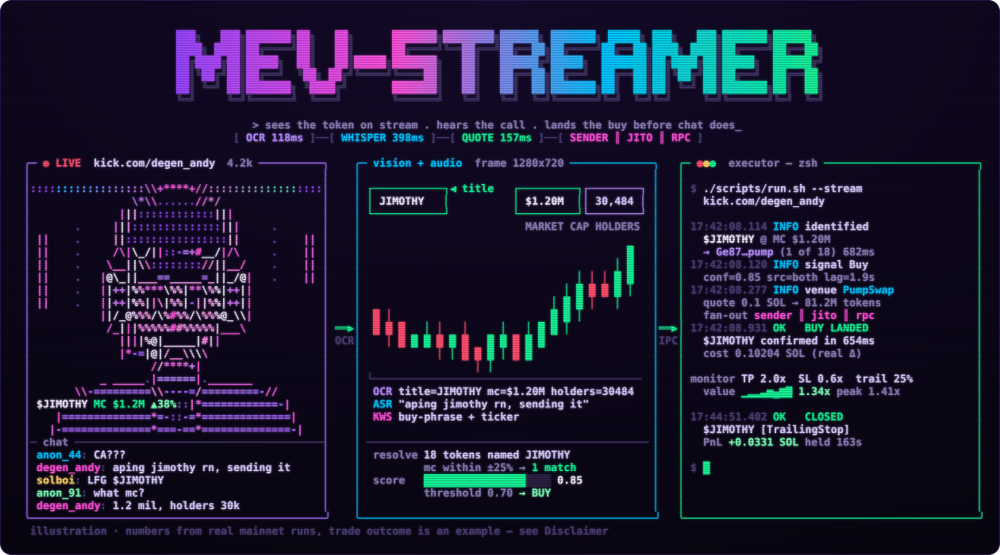
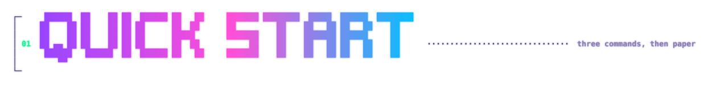
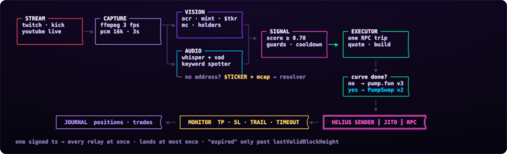
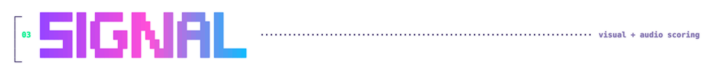
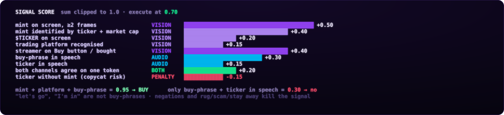
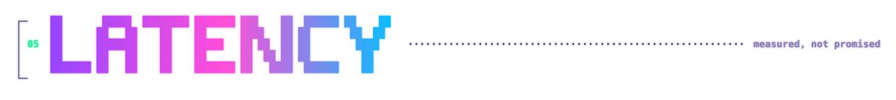
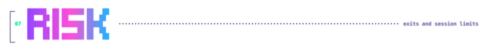
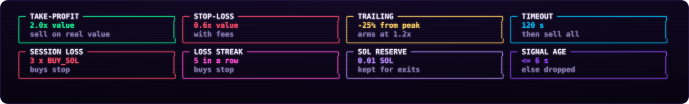
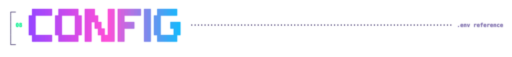
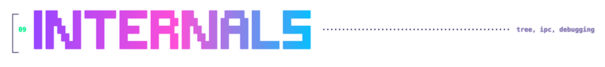

<p align="center"></p>

<p align="center">
  
  
  
  
  
</p>

<p align="center">
  <b><a href="#01--quick-start">[ start ]</a></b> ·
  <b><a href="#02--how-it-works">[ pipeline ]</a></b> ·
  <b><a href="#03--signal">[ signal ]</a></b> ·
  <b><a href="#04--no-address">[ no CA ]</a></b> ·
  <b><a href="#05--latency">[ latency ]</a></b> ·
  <b><a href="#06--pump-venues">[ venues ]</a></b> ·
  <b><a href="#07--risk">[ risk ]</a></b> ·
  <b><a href="#08--config">[ config ]</a></b> ·
  <b><a href="#09--internals">[ internals ]</a></b> ·
  <b><a href="#10--limits">[ limits ]</a></b>
</p>

<p align="center"></p>

**Стример открывает токен — бот уже в нём.** Python смотрит стрим и слушает голос: OCR кадра, Whisper, скоринг. Rust-executor за один RPC round-trip квотирует pump.fun bonding curve или PumpSwap-пул, подписывает одну транзакцию и рассылает её сразу в Helius Sender, Jito и RPC. Дальше — TP / SL / trailing / timeout по реальной стоимости позиции и журнал, переживающий рестарт.

<p align="center"></p>

<sub>Терминал — сборка из реальных строк логов dry-run на mainnet (цифры OCR, Whisper, CU, опознание $JIMOTHY и итог сессии — замеры). Сделка на обложке — пример.</sub>

<p align="center"></p>

<a id="01--quick-start"></a>
<p align="center"></p>

Нужны Python 3.11+ (лучше 3.13), Rust, `ffmpeg`.

```bash
./scripts/build.sh            # .venv, зависимости, cargo build --release, .env
$EDITOR .env                  # RPC_URL, STREAM_URL; WALLET_PRIVATE_KEY только для live
./scripts/check.sh            # 43 rust-теста, 56 unit checks, smoke — без стрима и GPU
```

Три режима, по нарастающей:

```bash
./scripts/monitor.sh --stream "kick.com/name"   # только сигналы, никуда не уходят
./scripts/dry-run.sh --stream "kick.com/name"   # настоящая tx симулируется на mainnet, позиция бумажная
./scripts/run.sh     --stream "kick.com/name"   # live: DRY_RUN=false, ключ и ввод LIVE
```

Перед первым live:

```bash
X=executor/target/release/mev-streamer-executor
$X --new-wallet ~/mevs-key.txt      # отдельный hot-кошелёк
$X --selfcheck     <MINT на кривой> # buy + полный выход против mainnet-симуляции, до лампорта
$X --selfcheck-amm <MINT на пуле>   # то же для PumpSwap
$X --probe-relays                   # релеи принимают формат? ничего не тратит
```

> [!IMPORTANT]
> Сначала paper. Базовая линия — случайные свежие токены, выход по таймауту: **13 сделок, 0 побед, −2.65%** — это ровно комиссии. Сигнал со стрима должен давать больше ~2.5% на круг, иначе края нет. Результаты бумажных сделок — `logs/trades.dry.jsonl`.

<p align="center"></p>

<a id="02--how-it-works"></a>
<p align="center"></p>

<p align="center"></p>

| фаза | модуль | что происходит |
|:---:|---|---|
| `1` | **capture** | `streamlink`/`yt-dlp` → два `ffmpeg`: кадры 1280×720 @ 3 fps и PCM 16 kHz по 3 с. Backoff 1→30 с, watchdog рвёт зависший HLS через 15 с. Всегда берётся самый свежий кадр — задержка не копится |
| `2` | **vision** | Apple Vision (ANE) или EasyOCR → mint, `$TICKER`, платформа, действие стримера, market cap / ликвидность / холдеры. Испорченный OCR-ом mint (`1→I`, `2→Z`, `o→0`) чинится и проверяется одним `getMultipleAccounts` |
| `3` | **audio** | faster-whisper + VAD, keyword spotter ловит buy/sell-фразы и тикеры |
| `4` | **signal** | окна vision 3 с / audio 10 с, скоринг, cooldown. Mint ≥ 2 кадров; несколько разных mint на экране (чат-оверлей) — BUY не уходит |
| `5` | **quote** | один round-trip: кривая + mint + канонический пул + хранилища ‖ priority fee ‖ blockhash ‖ баланс. Кривая жива → v3, мигрировал → PumpSwap v2 |
| `6` | **land** | одна подпись во все релеи — исполнится максимум один раз. «Не попала» — только когда высота блока перевалила `lastValidBlockHeight`, а не по таймеру |
| `7` | **manage** | себестоимость — реальная дельта баланса из tx. Выход по стоимости позиции (сколько вернёт продажа всего сейчас, с комиссиями), slippage на выходе растёт до `EXIT_SLIPPAGE_PCT`, ATA закрывается (≈0.002 SOL rent назад) |
| `8` | **journal** | `logs/positions.json` атомарно + `logs/trades.jsonl`. После рестарта — сверка с on-chain балансами |

<p align="center"></p>

<a id="03--signal"></a>
<p align="center"></p>

<p align="center"></p>

Вес mint умножается на 0.8–1.0 по OCR-confidence (восстановленный — не выше 0.9). Подтверждения от стримера — «смотрит токен» +0.10, «на кнопке Buy» +0.30, «купил» +0.40. Сигналы только по тикеру без mint по умолчанию не отправляются (`ALLOW_TICKER_ONLY=false`).

<p align="center"></p>

<a id="04--no-address"></a>
<p align="center"></p>

Стримеры редко показывают CA — чаще страницу токена: название, график, капитализация. Тикер у мемкоинов не уникален (десятки копий), а **тикер + market cap** почти всегда однозначны.

```
 кадр ─┬─▶ $JIMOTHY  (или крупный заголовок страницы)
       └─▶ MARKET CAP $1.2M · HOLDERS 30,484        ← vision/metrics.py, ATH и объём игнорируются
                    │
                    ▼
 DexScreener: 18 токенов с именем JIMOTHY ──▶ чья текущая MC в ±25% от экранной?
                    │
          ровно один ──▶ Ge87…pump, вес 0.40        несколько / ноль ──▶ не покупаем
```

На живом эфире: `identified $JIMOTHY at MC $1.20M → Ge87…pump (unique of 18, 682ms)`.

<p align="center"></p>

<a id="05--latency"></a>
<p align="center"></p>

<p align="center"></p>

На CPU без Apple Vision EasyOCR даёт 7–9 с на кадр — там нужен Tesseract или `STREAM_FPS=1`. Свой RPC и релей рядом важнее железа: executor почти всё время ждёт сеть. Задержку самой платформы стрима (секунды) не обогнать.

<p align="center"></p>

<a id="06--pump-venues"></a>
<p align="center"></p>

Источник истины — [pump-fun/pump-public-docs](https://github.com/pump-fun/pump-public-docs), IDL от 2026-10-13. Квоты — порт референсной математики `pump-rust-client` (MIT).

| | bonding curve | PumpSwap |
|---|---|---|
| инструкции | `buy_exact_quote_in_v3` / `sell_v3`, 17 аккаунтов | `buy_exact_quote_in_v2` / `sell_v2`, wrap → trade → unwrap в одной tx |
| комиссии | pump-fees `FeeConfig`, в трейде только buyback-доля | LP / protocol / creator по тирам капитализации |
| сверка | `--selfcheck`: buy до токена, полный выход до лампорта (3 mayhem-коина) | `--selfcheck-amm`: buy и выход до лампорта (3 пула) |
| compute | buy 70–75k CU, sell 46k | buy 81–84k, round trip 139–143k |
| round trip сразу | −2.5% | −0.6…−2% |

Позиция на кривой, которая мигрировала во время удержания, сама переезжает на пул. Mayhem-коины поддерживаются.

**Отклоняется с понятной причиной:** кривая не в SOL, cashback-коины и cashback-пулы, пулы не в wSOL, покупка, пересекающая остаток кривой, продажа больше реальных резервов. Все не-SOL кривые на mainnet заканчивались xStock'ами (`Xs…`, Token-2022), к которым из SOL нет pump-маршрута, — поэтому multi-hop отложен; `--inspect <MINT>` показывает цепочку.

<p align="center"></p>

<a id="07--risk"></a>
<p align="center"></p>

<p align="center"></p>

- **landing reconcile** — tx, приземлившаяся после «таймаута», не превращается в неучтённые токены и повторную покупку;
- **single instance** — второй executor на том же сокете не стартует (bind до открытия журнала);
- **честный paper** — бумажная позиция учитывает собственную покупку на кривой / в пуле, иначе выход считался бы по чужим резервам.

<p align="center"></p>

<a id="08--config"></a>
<p align="center"></p>

Все модули читают `.env` из корня, переменные окружения его перекрывают.

| переменная | default | |
|---|:-:|---|
| `RPC_URL` | — | свой / Helius — сильно быстрее публичного |
| `WALLET_PRIVATE_KEY` | пусто | base58; пусто → эфемерный ключ, только DRY_RUN |
| `STREAM_URL` | — | или `--stream` |
| `DRY_RUN` | `true` | |
| `BUY_SOL` | — | бюджет входа, комиссии внутри |
| `TAKE_PROFIT` / `STOP_LOSS` / `TIMEOUT_SEC` | 2.0 / 0.6 / 120 | множители стоимости позиции к себестоимости |
| `TRAILING_STOP` | 0.25 | от пика, взводится на 1.2×; 0 = выкл |
| `SLIPPAGE_PCT` / `EXIT_SLIPPAGE_PCT` | 15 / 40 | вход и TP / потолок для SL, timeout, повторов |
| `MAX_POSITIONS` | 3 | |

<details>
<summary><b>захват · vision · audio · signal</b></summary>

| переменная | default | |
|---|:-:|---|
| `STREAM_FPS` / `STREAM_AUDIO_CHUNK_SEC` | 3 / 3 | с Apple Vision FPS можно поднять до 5 |
| `STREAM_RESOLUTION` | `1280:720` | |
| `CAPTURE_STALL_TIMEOUT_SEC` | 15 | перезапуск ffmpeg без данных |
| `OCR_ENGINE` | `auto` | `applevision` / `easyocr` / `tesseract` |
| `OCR_GPU` / `OCR_MIN_CONFIDENCE` | true / 0.4 | для EasyOCR |
| `VISION_ROI_MODE` | `auto` | весь кадр для Apple Vision, зоны для остальных |
| `VISION_MINT_REPAIR` | true | исправление OCR-ошибок в mint |
| `UI_DETECTION` | true | платформа и действие |
| `WHISPER_MODEL` / `WHISPER_DEVICE` | `base.en` / auto | CUDA если есть, иначе CPU int8 |
| `SIGNAL_THRESHOLD` / `SIGNAL_COOLDOWN_SEC` | 0.7 / 60 | |
| `ALLOW_TICKER_ONLY` | false | BUY без mint на экране — риск копиката |
| `HELIUS_API_KEY` | из `RPC_URL` | проверка mint при резолве тикера |

</details>

<details>
<summary><b>отправка · комиссии · compute</b></summary>

| переменная | default | |
|---|:-:|---|
| `RELAYS` | `sender,jito` | `sender`, `jito`, `rpc` |
| `JITO_TIP` / `JITO_TIP_MAX` | `auto` / 0.001 | auto = p75 Jito `tip_floor`, обновление раз в 2 с |
| `JITO_URLS` | global | несколько регионов через запятую |
| `SENDER_TIP` / `HELIUS_SENDER_URL` | 0.000005 / `/fast` | ≥ 0.001 → Sender Max, меньше → `?swqos_only=true` |
| `PRIORITY_FEE` | `auto` | p75 недавних комиссий по этой кривой в `[MIN, MAX]` µL/CU |
| `CU_LIMIT_BUY` / `CU_LIMIT_SELL` | 90000 / 60000 | кривая |
| `CU_LIMIT_AMM_BUY` / `CU_LIMIT_AMM_SELL` | 100000 / 75000 | PumpSwap |
| `SIM_PAYER` | системный кошелёк | от чьего имени симулировать в DRY_RUN без ключа |

</details>

<details>
<summary><b>лимиты сессии · журнал · ipc</b></summary>

| переменная | default | |
|---|:-:|---|
| `MAX_SESSION_LOSS` | 3 × `BUY_SOL` | реализованный убыток → покупки стоп; 0 = выкл |
| `MAX_CONSECUTIVE_LOSSES` | 5 | |
| `MIN_SOL_RESERVE` | 0.01 | остаток на выход |
| `MAX_SIGNAL_AGE_MS` | 6000 | от захвата кадра / аудио |
| `MIN_CONFIDENCE` / `MAX_MCAP_SOL` / `REBUY` | 0 / выкл / false | |
| `MONITOR_INTERVAL_MS` / `STATE_DIR` | 400 / `logs` | |
| `IPC_SOCKET_PATH` / `SOCKET_PATH` | `/tmp/mev-streamer.sock` | скрипты синхронизируют обе |

</details>

<p align="center"></p>

<a id="09--internals"></a>
<p align="center"></p>

<p align="center"></p>

IPC — NDJSON по Unix-сокету (права 0600):

```
→ {"mint":"…pump","ticker":"X","action":"buy","confidence":0.85,"source":"both","context":"…","timestamp":1699999999.1}
← {"status":"ok","bundle_id":"<signature>"}     # "dry-run" в DRY_RUN
← {"status":"error","message":"…"}
```

Отладка и модули по отдельности (как скрипты, не `python -m` из корня — папка `signal/` затеняет stdlib):

```bash
./scripts/check.sh --network                       # + smoke с настоящим executor'ом
$X --inspect <MINT>                                # где торгуется каждый уровень цепочки квот
.venv/bin/python ingestion/capture.py kick.com/name --seconds 10 --save-frame /tmp/f.png
.venv/bin/python vision/pipeline.py screenshot.png --resize --text --engine applevision
.venv/bin/python audio/pipeline.py --text "aping into PEPE right now"
.venv/bin/python signal/ipc.py --mock
```

Картинки README генерирует `scripts/readme_art.py` (нужен `pyfiglet`).

<p align="center"></p>

<a id="10--limits"></a>
<p align="center"></p>

<p align="center"></p>

> [!WARNING]
> **Статус live.** Транзакции собираются по актуальному IDL, buy и полный выход сходятся с mainnet-симуляцией до лампорта, релеи принимают формат, восстановление из журнала проверено на mainnet с пустым кошельком. Реальная сделка с деньгами не проводилась, прибыльность стратегии не измерена — сначала paper, потом минимальный `BUY_SOL`.

> [!CAUTION]
> Экспериментальный проект для исследований и обучения, не финансовый совет. Мемкоины крайне волатильны, многие — скам, а сигналы в стримах можно подделать специально под такие боты. Автоторговля по чужому контенту может нарушать правила площадок. Используйте только то, что готовы потерять, держите на торговом кошельке минимум и не коммитьте `.env`.
